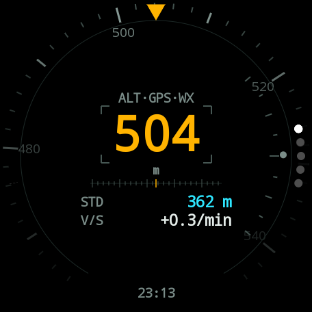
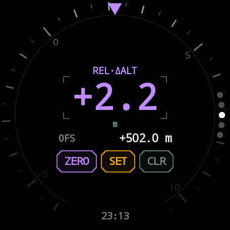
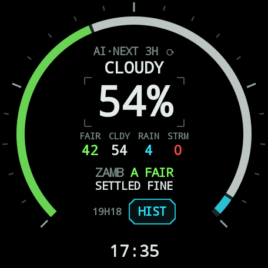
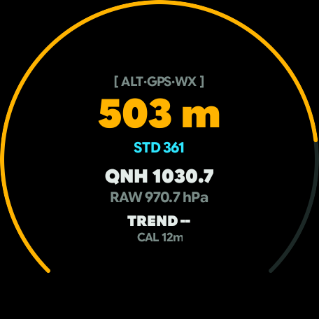

# AltiKit

A tactical altimeter and barometer toolkit for Wear OS, built for the Pixel Watch. It's lightweight and dark, with fine scale marks, and you drive it with the digital crown. Version 1.1 adds a Garmin-style automatic mode and an offline weather forecast that runs entirely on the watch.

<p>
  
  
  
  
  
  
</p>

## Features

**Six pages, switched with the crown**

| Page | Shows |
|---|---|
| **Altitude** | Calibrated altitude on a bezel scale that rotates with the reading, uncalibrated altitude (`STD`, based on 1013.25 hPa) and vertical speed. A change bar under the number shows how much you climbed or descended over the last 15 min, 1 h or 6 h (tap to switch) |
| **Barometer** | Calibrated sea-level pressure (`QNH`) on a 950–1050 hPa gauge, raw sensor pressure (`RAW`), and the 3-hour change with a marker showing where pressure was 3 hours ago. The change bar shows the weather pressure change over 1, 3 or 12 h (tap to switch) |
| **Relative** | `ZERO` sets the current altitude to 0, and `SET` sets it to any value you choose with the crown. The page then shows the offset from true altitude |
| **Trend** | A large graph of sea-level weather pressure over 3 to 48 hours (tap to switch) with a time axis, the 3-hour tendency and a storm warning |
| **Forecast** | The weather of the next 3, 6, 12 or 24 hours (tap to switch) from two offline forecasters. A small neural network gives the probability of fair, cloudy, rain and storm: the likeliest as a big percentage, all four in a row, and as a ring around the bezel. Below it, the classic Zambretti forecast. `HIST` lists both of the last 24 h side by side |
| **Setup** | Current calibration status, plus links to calibration and settings |

**Change bars**

The tape under the big number grows from the centre index: right and green for a rise, left and red (altitude) or amber (pressure) for a fall. Its scale adjusts so the bar always fits, and the exact change is shown next to the unit, e.g. `m · 1H ▲34`. If less history exists than the window, the label shows the span it covers (`12M`).

**Calibration**

- **GPS + weather QNH:** gets the local sea-level pressure from [Open-Meteo](https://open-meteo.com) (no API key needed) for your GPS position. Usually the most accurate method; needs an internet connection.
- **GPS altitude:** averages GPS fixes for 30 seconds, weighting each by its accuracy. On Wear OS 5 and newer the height is converted to height above mean sea level. Works offline.
- **Manual altitude:** enter a known elevation with the crown.
- **Manual QNH:** enter the sea-level pressure from a METAR or an airfield.
- **Reset:** go back to standard pressure (1013.25 hPa).

GPS results are shown with the change they would cause, so you can apply or discard them.

**Modes**

- **AUTO** (default for new installs): like the automatic mode on Garmin watches. Every pressure change is split between altitude and weather by how likely it is that you're moving, so altitude and sea-level pressure are both live at the same time. The pages show `AUTO·MOVE` or `AUTO·STILL`.
- **Altimeter:** QNH stays fixed and the altitude follows pressure changes.
- **Barometer:** the altitude stays fixed and QNH follows the weather. Use this when you're not moving.

Switching modes never makes the readings jump: the current altitude and QNH carry over.

How AUTO decides: weather rarely changes pressure faster than 1.5–4 hPa per hour (12–33 m/h). Faster changes are read as movement. With the step counter allowed (`ACTIVITY_RECOGNITION`, asked for when you pick AUTO), walking lowers that threshold so slow climbs count as height. Standing still raises it to vehicle speeds (lift, car, cable car), so the pressure jumps of a passing thunderstorm aren't read as height. AUTO keeps working in the background through the tile, complications and the trend logger.

Known limit, shared with Garmin's version: walking on flat ground while the weather changes quickly moves the altitude a little. Recalibrating fixes it.

**Offline forecast**

Both forecasters use only the watch's own pressure log and altitude. No internet, no location. The forecast runs when you open the Forecast page and whenever a new sample is logged. Tapping the page switches the AI between 3, 6, 12 and 24 hours ahead; one pass of the network computes all four. Zambretti has no horizon of its own and is traditionally read as the next 12 hours or so. With **forecast alerts** on, it also runs after every background sample, and the watch vibrates with a notification when rain or a storm newly becomes likely in the next 12 hours. Alerts come from the AI by default, since it catches about twice as many wet periods, and can be switched to Zambretti. A rapid pressure fall (3 hPa or more in 3 h) always alerts. The tile shows the alert source's forecast too.

The neural network was trained on six years of hourly weather from 55 places, weighted toward Germany and the Alps. On 2024 data from Germany and the Alps that it was never trained on (accuracy over the four classes; "wet" means rain or storm):

| Horizon | AI accuracy | Zambretti | Climatology | AI wet hit rate | AI wet false alarms |
|---|---|---|---|---|---|
| 3 h | 52% | 39% | 43% | 10% | 52% |
| 6 h | 48% | 39% | 39% | 26% | 47% |
| 12 h | 45% | 39% | 36% | 50% | 42% |
| 24 h | 48% | 36% | 31% | 68% | 32% |

"Climatology" always predicts the most common weather for the month, the bar any forecaster has to clear. The AI beats it and Zambretti at every horizon, also at three places it never saw in training. Zambretti, read as its letters say, rarely forecasts rain or storms (it catches about a quarter of the wet 12-hour periods). Forecasting from pressure alone has limits: treat the percentages as odds, not certainties.

Details, the training scripts and the full evaluation are in [tools/forecast](tools/forecast/README.md).

Power: one prediction, all four horizons at once, is about 2,000 multiply-adds, which takes microseconds on the CPU. An NPU would cost more in setup and data copies than the maths itself, so the network runs in plain Kotlin. It only runs when you look at the page, or inside the background sample that already wakes the watch every 15–60 minutes. It adds no extra wakeups, no sensors and no library, and the APK stays at 3.6 MB.

**Settings**

- Metric (m/hPa) or imperial (ft/inHg) units.
- Background trend logging every 15, 30 or 60 minutes, or off. The forecast needs at least 3 hours of log.
- Forecast alerts on or off, alert source (Zambretti or AI), and a test alert to check the vibration.

**Watch face integration**

<p>
  
  
</p>

- **Tile:** altitude, uncalibrated altitude, QNH, raw pressure, 3-hour trend, forecast and a QNH arc. Tap it to open the app.
- **Complications:** *AltiKit Altitude* and *AltiKit Pressure*, each in short-text, long-text and ranged-value (ring) formats.

## Digital crown

| Where | Crown does |
|---|---|
| Main pages | Moves one page at a time, with the system snapping and haptics |
| Calibration and settings lists | Scrolls |
| Value editors | Changes the value by the selected step. Spin fast to move 10× faster. Each step gives a haptic tick |

## Requirements

- A Wear OS watch with a barometer. Minimum is Wear OS 3 (API 30). Tested on a Pixel Watch 3 running API 37.
- Location permission for GPS calibration, requested only when you use it.
- Optional: physical activity (step counter) for AUTO mode, and notifications for forecast alerts. Both are requested only when you turn the feature on.
- An internet connection (Wi-Fi, LTE or through your phone) for GPS + weather calibration only.

## Building

You need JDK 17 and the Android SDK (platform 35).

```sh
./gradlew assembleRelease
./gradlew testDebugUnitTest   # AUTO maths, trend log, alert rules, forecast port vs. Python
```

The release APK is about 3.6 MB, minified and signed with the debug key so it can be sideloaded:
`app/build/outputs/apk/release/app-release.apk`

## Installing on the watch

1. On the watch, go to **Settings → System → About → Versions** and tap **Build number** 7 times.
2. Go to **Settings → Developer options** and turn on **ADB debugging** and **Wireless debugging**. The watch must be on the same Wi-Fi as your computer.
3. Tap **Pair new device**, then pair and install:

```sh
adb pair <ip>:<pairing-port> <code>
adb connect <ip>:<port>        # or let adb find the watch on the network automatically
adb install -r app/build/outputs/apk/release/app-release.apk
```

Then add the tile from the tile editor, and the complications from any watch face's edit screen.

## Project layout

```
app/src/main/java/app/altikit/
├── core/          Atmosphere math, sensor stream, AUTO mode, step counter, calibration config, trend log, GPS, weather
│   └── forecast/  Feature extraction, neural network (3/6/12/24 h), Zambretti, forecast log
├── ui/            Compose for Wear OS screens, instruments (dials, gauges, change bars), crown handling
├── tile/          Tile built with ProtoLayout
├── complication/  Altitude and pressure complication services
└── work/          WorkManager trend logger, forecast alerts, tile/complication refresh
tools/forecast/    Training data download, network training and evaluation (Python + numpy)
testface/          Minimal Watch Face Format face for testing the complications
```

## How the readings relate

All conversions use the International Standard Atmosphere formulas:

- **Altitude:** `h = 44330.77 × (1 − (p / QNH)^0.190263)`
- **Sea-level pressure:** `QNH = p / (1 − h / 44330.77)^(1 / 0.190263)`

Here `p` is the raw (uncalibrated) station pressure from the sensor. Calibrating means finding the QNH that makes the altitude correct. `STD` altitude uses QNH = 1013.25 hPa, which makes it the uncalibrated reading.

In AUTO mode each pressure change `p₁ → p₂` is split with the moving probability `w`:
`alt += w · (h(p₂, QNH) − h(p₁, QNH))`, then `QNH = sea level(p₂, alt)`. With `w = 1` QNH stays put, and with `w = 0` the altitude does.

The trend log stores the sea-level weather pressure, not the raw sensor pressure, so walking up a hill doesn't look like a weather front. Logs from version 1.0 are converted on the first start.

Relative mode stores the reference as a pressure rather than an altitude. That way it keeps tracking correctly when you switch modes. In AUTO mode it also ignores weather drift while you stand still.
