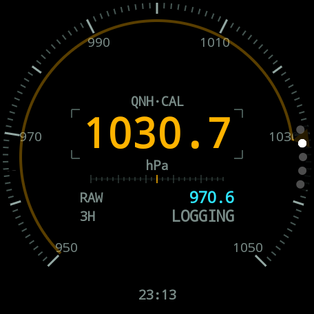
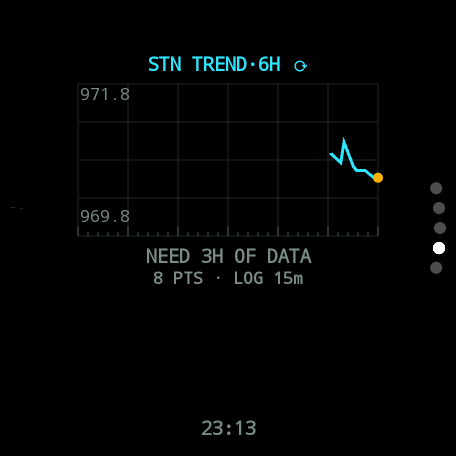
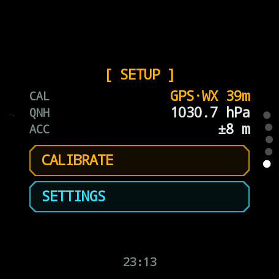
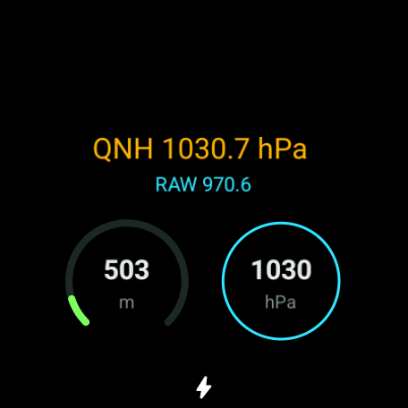

# AltiKit

A tactical altimeter and barometer toolkit for Wear OS, built for the Pixel Watch. It's lightweight and dark, with fine scale marks, and you drive it with the digital crown.

<p>
  
  
  
  
  
</p>

## Features

**Five pages, switched with the crown**

| Page | Shows |
|---|---|
| **Altitude** | Calibrated altitude on a bezel scale that rotates with the reading, uncalibrated altitude (`STD`, based on 1013.25 hPa) and vertical speed |
| **Barometer** | Calibrated sea-level pressure (`QNH`) on a 950–1050 hPa gauge, raw sensor pressure (`RAW`), and the 3-hour change with a marker showing where pressure was 3 hours ago |
| **Relative** | `ZERO` sets the current altitude to 0, and `SET` sets it to any value you choose with the crown. The page then shows the offset from true altitude |
| **Trend** | Station pressure graph over 3 to 48 hours (tap to switch), the 3-hour tendency and a storm warning |
| **Setup** | Current calibration status, plus links to calibration and settings |

**Calibration**

- **GPS + weather QNH:** gets the local sea-level pressure from [Open-Meteo](https://open-meteo.com) (no API key needed) for your GPS position. Usually the most accurate method; needs an internet connection.
- **GPS altitude:** averages GPS fixes for 30 seconds, weighting each by its accuracy. On Wear OS 5 and newer the height is converted to height above mean sea level. Works offline.
- **Manual altitude:** enter a known elevation with the crown.
- **Manual QNH:** enter the sea-level pressure from a METAR or an airfield.
- **Reset:** go back to standard pressure (1013.25 hPa).

GPS results are shown with the change they would cause, so you can apply or discard them.

**Modes and settings**

- **Altimeter mode:** QNH stays fixed and the altitude follows pressure changes.
- **Barometer mode:** the altitude stays fixed and QNH follows the weather. Use this when you're not moving.
- Metric (m/hPa) or imperial (ft/inHg) units.
- Background trend logging every 15, 30 or 60 minutes, or off.

**Watch face integration**

<p>
  
  
</p>

- **Tile:** altitude, uncalibrated altitude, QNH, raw pressure, 3-hour trend and a QNH arc. Tap it to open the app.
- **Complications:** *AltiKit Altitude* and *AltiKit Pressure*, each in short-text, long-text and ranged-value (ring) formats.

## Digital crown

| Where | Crown does |
|---|---|
| Main pages | Moves one page at a time, with the system snapping and haptics |
| Calibration and settings lists | Scrolls |
| Value editors | Changes the value by the selected step. Spin fast to move 10× faster. Each step gives a haptic tick |

## Requirements

- A Wear OS watch with a barometer. Minimum is Wear OS 3 (API 30). Tested on a Pixel Watch 3 running API 37.
- Location permission for GPS calibration, requested only when you use it.
- An internet connection (Wi-Fi, LTE or through your phone) for GPS + weather calibration.

## Building

You need JDK 17 and the Android SDK (platform 35).

```sh
./gradlew assembleRelease
```

The release APK is about 3.6 MB, minified and signed with the debug key so it can be sideloaded:
`app/build/outputs/apk/release/app-release.apk`

## Installing on the watch

1. On the watch, go to **Settings → System → About → Versions** and tap **Build number** 7 times.
2. Go to **Settings → Developer options** and turn on **ADB debugging** and **Wireless debugging**. The watch must be on the same Wi-Fi as your computer.
3. Tap **Pair new device**, then pair and install:

```sh
adb pair <ip>:<pairing-port> <code>
adb connect <ip>:<port>        # or let adb find the watch on the network automatically
adb install -r app/build/outputs/apk/release/app-release.apk
```

Then add the tile from the tile editor, and the complications from any watch face's edit screen.

## Project layout

```
app/src/main/java/app/altikit/
├── core/          Atmosphere math, sensor stream, calibration config, trend log, GPS, weather
├── ui/            Compose for Wear OS screens, instruments (dials, gauges, rulers), crown handling
├── tile/          Tile built with ProtoLayout
├── complication/  Altitude and pressure complication services
└── work/          WorkManager trend logger and tile/complication refresh
testface/          Minimal Watch Face Format face for testing the complications
```

## How the readings relate

All conversions use the International Standard Atmosphere formulas:

- **Altitude:** `h = 44330.77 × (1 − (p / QNH)^0.190263)`
- **Sea-level pressure:** `QNH = p / (1 − h / 44330.77)^(1 / 0.190263)`

Here `p` is the raw (uncalibrated) station pressure from the sensor. Calibrating means finding the QNH that makes the altitude correct. `STD` altitude uses QNH = 1013.25 hPa, which makes it the uncalibrated reading.

Relative mode stores the reference as a pressure rather than an altitude. That way it keeps tracking correctly when you switch between altimeter and barometer mode.
